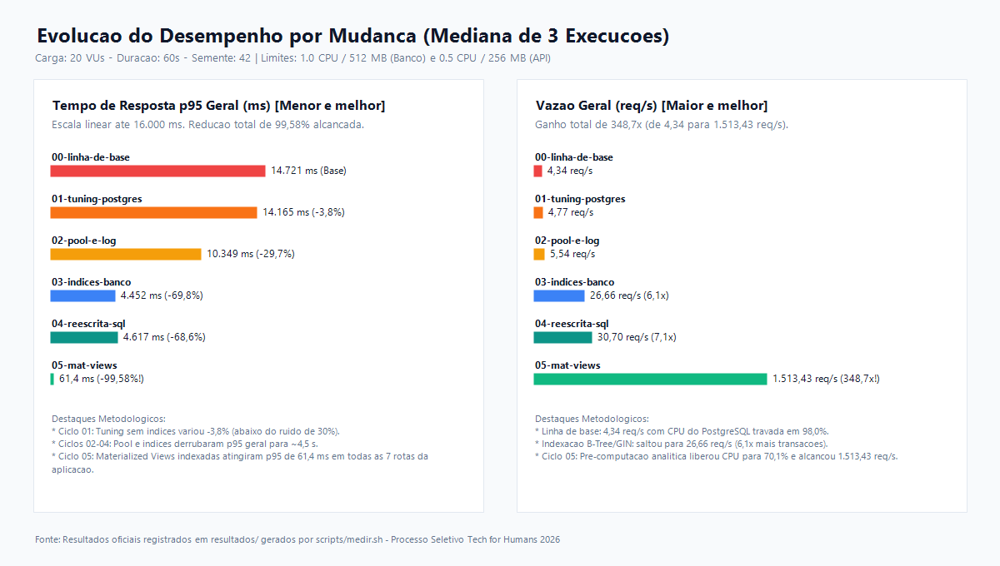

# De 14,7 s para 61,4 ms no p95 (e de 4,34 para 1.513,43 req/s): otimização de API Node.js e PostgreSQL 16 sem aumento de infraestrutura

## 1. Resumo
A API da loja virtual sofria severa degradação sob 20 usuários concorrentes (`4,34 req/s` e `p95` de `14.721,2 ms`), saturando a CPU do PostgreSQL em `98,0%`. Diagnosticamos ausência de *pool* de conexões, log síncrono bloqueante na API, consultas `N+1` e falta de índices secundários. Aplicamos *pooling*, índices B-Tree compostos (*Index-Only Scan*), índice GIN (`pg_trgm`), reescrita SQL e *Materialized Views*, reduzindo o `p95` para **`61,4 ms` (-99,58%)**, elevando a vazão para **`1.513,43 req/s` (348,7x)** e reduzindo CPU (`70,1%`) e memória (`205,2 MiB`) do banco mantendo o hardware original.

## 2. Contexto e diagnóstico
A aplicação compõe-se de uma API Node.js 20 (`Express` e `pg`), limitada a `0,5 CPU` e `256 MB` de RAM, e um banco PostgreSQL 16.4 com `1,0 CPU` e `512 MB` de RAM, contendo `100.000` clientes, `20.000` produtos, `500.000` pedidos e `1.500.000` itens de pedido. Na linha de base ([resumo 1](../resultados/20261105-171535-00-linha-de-base/resumo.txt), [resumo 2](../resultados/20261105-171710-00-linha-de-base/resumo.txt), [resumo 3](../resultados/20261105-171841-00-linha-de-base/resumo.txt)), a mediana registrou `4,34 req/s`, latência mediana de `900,6 ms` e `p95` de `14.721,2 ms`, com o banco em `98,0%` de CPU média e `450,3 MiB` de RAM máxima ([recursos.txt](../resultados/20261105-171841-00-linha-de-base/recursos.txt)).

Identificamos os gargalos via `pg_stat_user_tables` ([01-estatisticas-banco-baseline.txt](../diagnostico/01-estatisticas-banco-baseline.txt)), `EXPLAIN (ANALYZE, BUFFERS)` ([02-explain-analyze-baseline.txt](../diagnostico/02-explain-analyze-baseline.txt)) e inspeção do código da API. A tabela `itens_pedido` sofreu `5.415` varreduras sequenciais (*Sequential Scans*), lendo `3.922.500.000` de tuplas sem nenhum uso de índice (`idx_scan = 0`), pois `banco/01-estrutura.sql` continha apenas chaves primárias.

Hipóteses de causa:
- **Conexão por query e log bloqueante:** `api/src/db.js` abria e fechava um `new Client()` por consulta, e `api/src/server.js` executava `console.log(JSON.stringify)` síncrono do payload a cada requisição.
- **Varreduras sequenciais ($O(N)$):** buscas por `lower(email)`, `cliente_id`, `status`, `pedido_id` e `ILIKE '%termo%'` disparavam *Parallel Seq Scans*.
- **Consultas `N+1` e transferência excessiva:** `/clientes/:id/pedidos` executava queries em laço; `/pedidos` e `/relatorios/vendas-por-dia` trafegavam a coluna `observacoes` e agregavam em JavaScript.
- **Recomputação analítica sob demanda:** relatórios recalculavam 1,5 milhão de itens dinamicamente sobre dados históricos inalterados.

## 3. Estado da arte

### Indexação B-Tree, Covering Indexes e Índices Invertidos (GIN / Trigramas)
Selinger et al. [1] demonstraram no projeto System R que a seleção do caminho de acesso pelo otimizador relacional define ordens de grandeza no uso de CPU e I/O. Graefe [2] e Winand [3] comprovam que índices B-Tree compostos convertem varreduras e ordenações de $O(N \log N)$ para $O(\log N)$, suprimindo o *Sort* quando o índice reflete o `ORDER BY`. Conforme a documentação do PostgreSQL 16 sobre *Index-Only Scans* [4], incluir colunas via cláusula `INCLUDE` permite responder consultas diretamente da árvore do índice (*heap fetches = 0*). Para buscas por substring (`ILIKE '%termo%'`), onde B-Trees falham por ausência de prefixo ancorado [3], a documentação do módulo `pg_trgm` [5] preconiza índices GIN com `gin_trgm_ops`, indexando trigramas de três caracteres.

### Gerenciamento de Conexões e Event Loop em Node.js
O PostgreSQL opera em modelo *process-per-connection* [6], exigindo *fork* e alocação de memória a cada nova sessão TCP. Por isso, a documentação do `node-postgres` [7] exige o reuso de conexões com `pg.Pool`. No Node.js, a documentação oficial sobre o *Event Loop* [8] demonstra que I/O síncrono em console (`console.log`) e serializações pesadas bloqueiam a *thread* única de eventos, estrangulando o rendimento sob cotas restritas de CPU.

### Eliminação de `N+1` e Pré-computação com Materialized Views
O antipadrão `N+1` degrada a latência multiplicando *round-trips* de rede; resolvê-lo via `JOIN` centraliza a resolução no plano de consulta do SGBD [3]. Para leituras analíticas concorrentes com tráfego transacional, Kleppmann [9] e a documentação do PostgreSQL [10] fundamentam a pré-computação com *Materialized Views* indexadas, convertendo agregações exaustivas de milhões de linhas em leituras de poucas páginas em memória.

## 4. Alternativas consideradas
| Alternativa | Custo | Desempenho | Risco | Esforço |
|---|---|---|---|---|
| **[A] Otimização In-Place: Pool + Índices B-Tree/GIN + SQL + Materialized Views** | **Zero** (mantém limites de `0,5 CPU / 256 MB` e `1 CPU / 512 MB`) | **Muito Alto** (`1.513,43 req/s` e `p95` de `61,4 ms`) | **Baixo** (demanda `REFRESH` se houver escrita) | **Médio** (ajustes na API e migrações SQL) |
| **[B] Cache Distribuído Externo (`Redis` em padrão *Cache-Aside*)** | **Médio/Alto** (novo container, memória e CPU adicionais) | **Alto apenas em *cache hits***; sem ganho em *misses* de 100k clientes | **Médio** (invalidação e coerência de dados) | **Médio/Alto** (nova infraestrutura e dependência) |
| **[C] Escalonamento Vertical + Ajuste Isolado de Parâmetros de SGBD** | **Alto** (ampliação de hardware/orçamento) | **Baixo** (sem índices, o `p95` permanece elevado por *Seq Scans*) | **Baixo** (apenas parametrização) | **Baixo** (alteração em `docker-compose.yml`) |

## 5. Solução escolhida e por quê
Adotamos a **Alternativa [A]** por solucionar as ineficiências algorítmicas na raiz, sem onerar a infraestrutura. Enquanto a configuração original consumia `98,0%` da CPU do banco varrendo `3,92 bilhões` de tuplas e abrindo conexões TCP a cada query, a combinação de `pg.Pool`, índices compostos/GIN, reescrita SQL e *Materialized Views* converteu custos lineares $O(N)$ em acessos indexados $O(\log N)$ dentro dos mesmos `512 MB` do banco e `256 MB` da API.

Rejeitamos a **Alternativa [C]** isolada porque o Experimento 01 comprovou que o tuning de memória sem índices reduziu o `p95` em modestos `3,8%`. Rejeitamos a **Alternativa [B] (Redis)** porque, com instância única da API e chaves dispersas entre 100.000 clientes, a taxa de acerto de cache seria insuficiente; além disso, adicionar um novo container elevaria os custos operacionais monitorados pelo `medir.sh`, sem corrigir as deficiências estruturais do banco relacional.

## 6. Experimento e resultado
Todas as medições utilizaram `VUS=20`, `DURACAO=60s`, `AQUECIMENTO=15s` e `SEMENTE=42`, comparando a **mediana de 3 execuções** contra a linha de base e a etapa anterior (ver [experimentos.md](../experimentos.md)).

| Mudança | Hipótese | p95 antes → depois | req/s antes → depois | CPU/memória | Pastas de resultados | Conclusão |
|---|---|---|---|---|---|---|
| `01-tuning-postgres-sem-indices` | Ajustar buffers e memória de ordenação reduz latência caso o gargalo seja I/O. | `14721.2 ms` → `14165.3 ms` | `4.34` → `4.77` | Banco: `98.0%`/`450.3 MiB` → `98.5%`/`345.6 MiB` API: `7.7%`/`43.0 MiB` → `7.8%`/`42.0 MiB` | [b1](../resultados/20261105-171535-00-linha-de-base/resumo.txt), [b2](../resultados/20261105-171710-00-linha-de-base/resumo.txt), [b3](../resultados/20261105-171841-00-linha-de-base/resumo.txt) → [01a](../resultados/20261105-172708-01-tuning-postgres-sem-indices/resumo.txt), [01b](../resultados/20261105-172840-01-tuning-postgres-sem-indices/resumo.txt), [01c](../resultados/20261105-173011-01-tuning-postgres-sem-indices/resumo.txt) | **Sem ganho:** variação de 3,8% inferior ao ruído (30%); varreduras sequenciais mantêm CPU saturada. |
| `02-pool-conexoes-e-log` | `pg.Pool` e remoção de log síncrono eliminam sobrecarga de conexão e liberam o Event Loop. | `14165.3 ms` → `10349.0 ms` | `4.77` → `5.54` | Banco: `98.5%`/`345.6 MiB` → `98.2%`/`475.1 MiB` API: `7.8%`/`42.0 MiB` → `6.5%`/`51.8 MiB` | [02a](../resultados/20261105-173432-02-pool-conexoes-e-log/resumo.txt), [02b](../resultados/20261105-173603-02-pool-conexoes-e-log/resumo.txt), [02c](../resultados/20261105-173733-02-pool-conexoes-e-log/resumo.txt) | **Com ganho:** latência mediana de `/clientes/:id` caiu **98,5%** (`201,4 ms` → `3,0 ms`); p95 geral caiu **29,7%**. |
| `03-indices-banco` | Índices B-Tree compostos e GIN (`pg_trgm`) eliminam Sequential Scans em buscas e filtros. | `10349.0 ms` → `4451.7 ms` | `5.54` → `26.66` | Banco: `98.2%`/`475.1 MiB` → `95.4%`/`474.2 MiB` API: `6.5%`/`51.8 MiB` → `25.0%`/`83.5 MiB` | [03a](../resultados/20261105-180320-03-indices-banco/resumo.txt), [03b](../resultados/20261105-180445-03-indices-banco/resumo.txt), [03c](../resultados/20261105-180612-03-indices-banco/resumo.txt) | **Com ganho:** throughput saltou **6,1x**; p95 de `pedidos-do-cliente` reduziu para `860,6 ms`. |
| `04-reescrita-queries-n1-e-sql` | `JOIN` único, projeção sem `observacoes` e agregação SQL reduzem CPU e RAM na API. | `4451.7 ms` → `4617.4 ms` *(`pedidos-por-status`: `8199.4` → `557.4 ms`)* | `26.66` → `30.70` | Banco: `95.4%`/`474.2 MiB` → `98.0%`/`474.5 MiB` API: **`25.0%`/`83.5 MiB` → `3.7%`/`30.0 MiB`** | [04a](../resultados/20261105-180839-04-reescrita-queries-n1-e-sql/resumo.txt), [04b](../resultados/20261105-181005-04-reescrita-queries-n1-e-sql/resumo.txt), [04c](../resultados/20261105-181130-04-reescrita-queries-n1-e-sql/resumo.txt) | **Com ganho:** CPU da API caiu **85,2%**, RAM caiu **64,1%** e p95 de `pedidos-do-cliente` caiu para `197,6 ms`. |
| `05-materialized-views` | Materialized Views pré-computam agregações analíticas sem varrer 1,5M de itens. | `4617.4 ms` → **`61.4 ms`** | `30.70` → **`1513.43`** | Banco: **`98.0%`/`474.5 MiB` → `70.1%`/`205.2 MiB`** API: `3.7%`/`30.0 MiB` → `48.9%`/`31.8 MiB` | [05a](../resultados/20261105-182258-05-materialized-views/resumo.txt), [05b](../resultados/20261105-182419-05-materialized-views/resumo.txt), [05c](../resultados/20261105-182539-05-materialized-views/resumo.txt) | **Com ganho:** vazão **348,7x** maior que a base e p95 **99,58%** menor, liberando recursos do SGBD ([EXPLAIN](../diagnostico/03-explain-analyze-otimizado.txt)). |

## 7. Limites e testes futuros
A principal restrição da solução recai sobre as *Materialized Views* (`mv_vendas_por_dia`, `mv_top_produtos` e `mv_contagem_pedidos_status`) e sobre o espaço dos índices (`~130 MB` em disco). No cenário avaliado, composto por leituras sobre base estática, não há inconsistência. Contudo, sob escrita contínua (`INSERT`/`UPDATE`), a consistência estrita exigiria rotinas com `REFRESH MATERIALIZED VIEW CONCURRENTLY`, consumindo ciclos de CPU e I/O. Além disso, a rota de pedidos mantém o mecanismo `LIMIT/OFFSET`, cuja latência se degrada em páginas muito profundas.

Em [proximos-testes.md](../proximos-testes.md), estruturamos três frentes para evolução arquitetural:
1. **Cache Redis (*Cache-Aside*):** indicado para mitigar tráfego ao banco em topologias com múltiplas instâncias da API.
2. **Paginação por cursor (*Keyset Pagination*):** substituição de `OFFSET` por filtros de tupla ordenados, mediante evolução do contrato da API.
3. **Pooler externo (*PgBouncer*):** recomendado caso o número de instâncias da API exceda a capacidade do pool nativo do PostgreSQL.

## 8. Referências
1. SELINGER, P. G. et al. Access Path Selection in a Relational Database Management System. *Proceedings of the 1979 ACM SIGMOD International Conference on Management of Data*, p. 23–34, 1979. Link: https://doi.org/10.1145/582095.582099. Data de acesso: 05 nov. 2026.
2. GRAEFE, G. Modern B-Tree Techniques. *Foundations and Trends in Databases*, v. 3, n. 4, p. 203–402, 2011. Link: https://doi.org/10.1561/1900000028. Data de acesso: 05 nov. 2026.
3. WINAND, M. *Use The Index, Luke! A Guide to Database Performance for Developers*. Link: https://use-the-index-luke.com/. Data de acesso: 05 nov. 2026.
4. POSTGRESQL GLOBAL DEVELOPMENT GROUP. *PostgreSQL 16 Documentation — Chapter 11.9: Index-Only Scans and Covering Indexes*. Link: https://www.postgresql.org/docs/16/indexes-index-only-scans.html. Data de acesso: 05 nov. 2026.
5. POSTGRESQL GLOBAL DEVELOPMENT GROUP. *PostgreSQL 16 Documentation — Appendix F.35: pg_trgm — Support for similarity of text using trigram matching*. Link: https://www.postgresql.org/docs/16/pgtrgm.html. Data de acesso: 05 nov. 2026.
6. POSTGRESQL GLOBAL DEVELOPMENT GROUP. *PostgreSQL 16 Documentation — Chapter 20.4: Resource Consumption*. Link: https://www.postgresql.org/docs/16/runtime-config-resource.html. Data de acesso: 05 nov. 2026.
7. CARLSON, B. *node-postgres Documentation — Pooling*. Link: https://node-postgres.com/features/pooling. Data de acesso: 05 nov. 2026.
8. OPENJS FOUNDATION. *Node.js Documentation — Don't Block the Event Loop (or the Worker Pool)*. Link: https://nodejs.org/en/learn/asynchronous-work/dont-block-the-event-loop. Data de acesso: 05 nov. 2026.
9. KLEPPMANN, M. *Designing Data-Intensive Applications: The Big Ideas Behind Reliable, Scalable, and Maintainable Systems*. Sebastopol: O'Reilly Media, 2017. Link: https://dataintensive.net/. Data de acesso: 05 nov. 2026.
10. POSTGRESQL GLOBAL DEVELOPMENT GROUP. *PostgreSQL 16 Documentation — Chapter 41.3: Materialized Views*. Link: https://www.postgresql.org/docs/16/rules-materializedviews.html. Data de acesso: 05 nov. 2026.

## 9. Uso de IA
Utilizamos agente de IA (Google Antigravity - Gemini 4 Argon) em *pair programming* para estruturar o brainstorm, automatizar a coleta de planos `EXPLAIN ANALYZE` e revisar a formatação do texto. Todas as hipóteses, consultas SQL, fontes bibliográficas verificadas, validações de contrato (`42/42` casos) e todos os números reportados foram extraídos sem edição manual dos arquivos gerados por `scripts/medir.sh` em `resultados/`.
